

  

  
  
  
  
  
  
  

### About me

- I spend my days on red team operations and inside malware binaries :computer:
- OSCP+, CPTS, Hack The Box **Omniscient** :skull:
- Arch and BlackArch daily driver :alien:
- Love playing CTFs in my free time :mount_fuji:

### Technologies in my environment:

  
  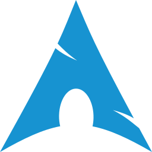
  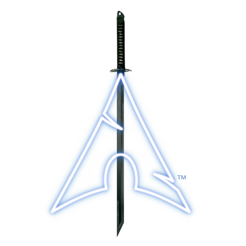
  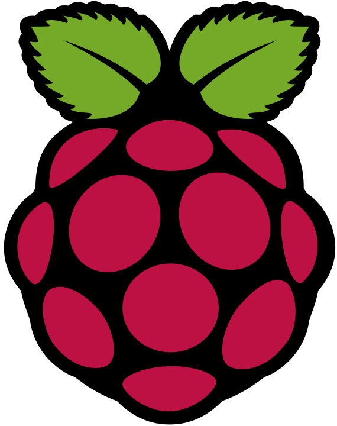
  
  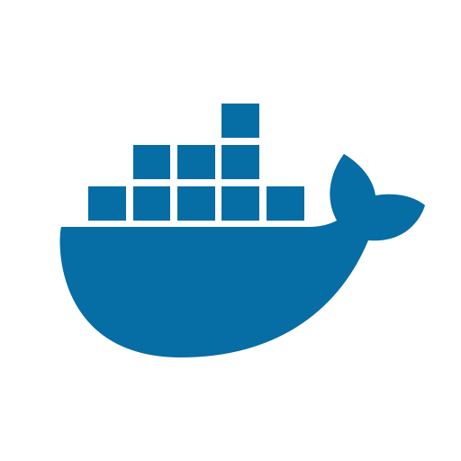

### Tools i use:

  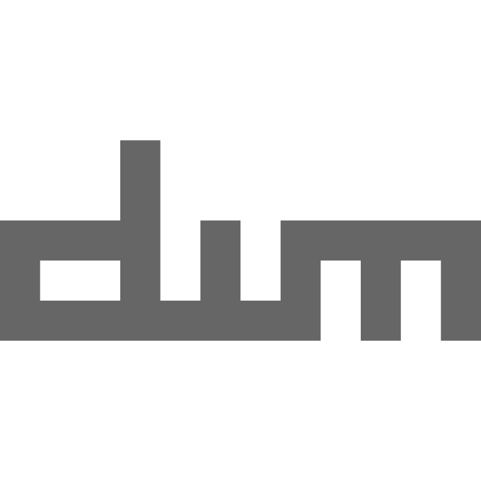
  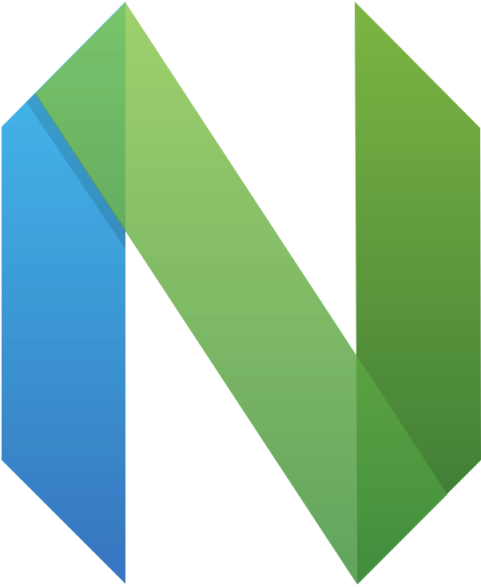
  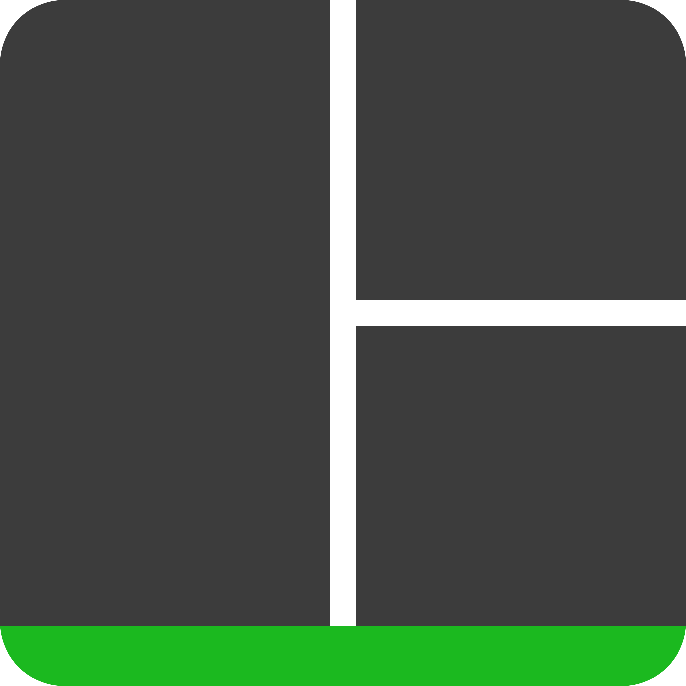

### Languages:

  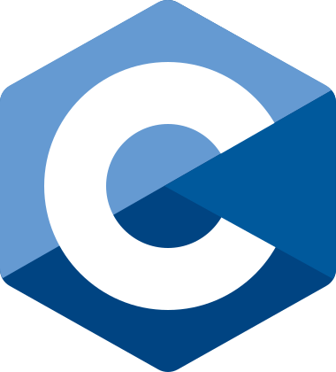
  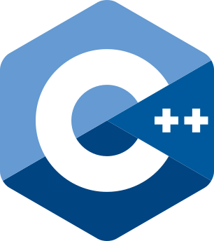
  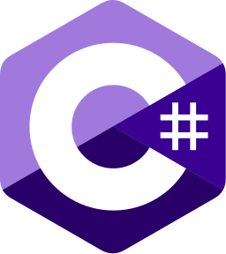
  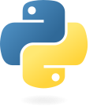
  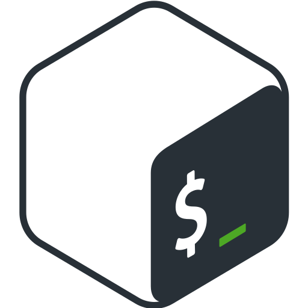
  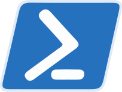
  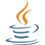
  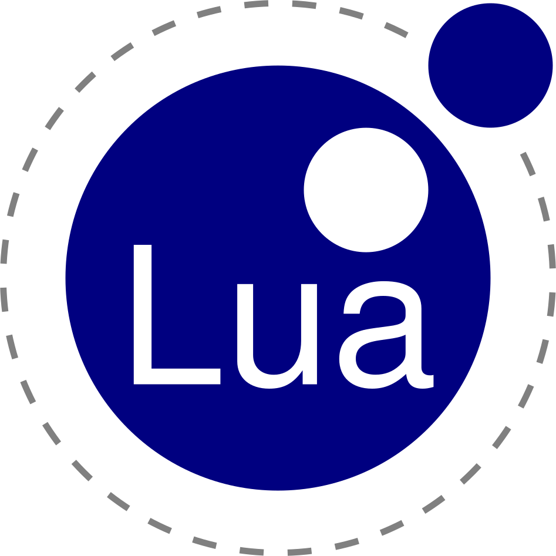

  
  
  

